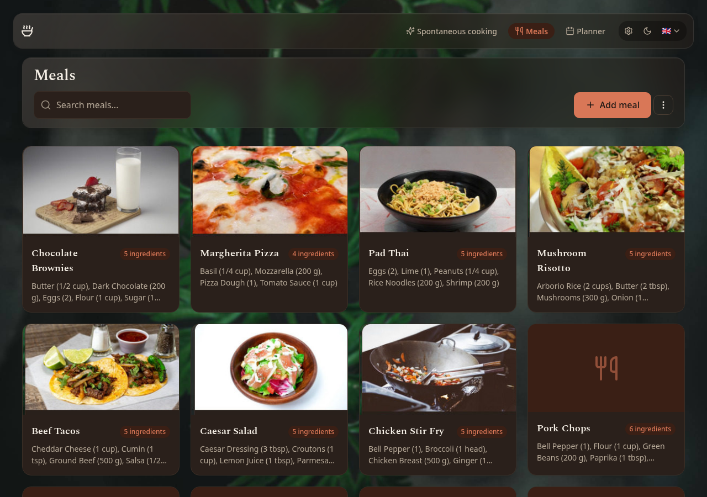

<p align="center">
  
</p>

<p align="center">
  <a href="https://github.com/RouHim/yummybox/actions/workflows/ci.yml"></a>
  <a href="https://github.com/RouHim/yummybox/releases/latest"></a>
  <a href="https://github.com/RouHim/yummybox/releases/latest"></a>
</p>

<p align="center">
  A local-first meal manager for your recipes, weekly plans, and shopping lists.
</p>

<p align="center">
  <picture>
    <source media="(prefers-color-scheme: dark)" srcset=".github/readme/screenshot-dark.png">
    <source media="(prefers-color-scheme: light)" srcset=".github/readme/screenshot-light.png">
    
  </picture>
</p>

## How it works

YummyBox is one binary that serves a web interface and keeps your collection in a single SQLite file. Open its address in a browser; YummyBox itself has no account and no cloud service.

Recipes arrive by hand, from recipe page URLs, a Mealie backup, or a photo and text hint handled by a vision model you configure. The planner prefers meals you have not planned recently, merges the ingredients for a week, and sends items to Bring! on request.

## Features

- Keep a searchable collection of meals with ingredients, quantities, instructions, photos, and servings.
- Cook from a dedicated view that renders formatted instructions and scales quantities to the serving count you choose.
- Plan a week from your collection, add or remove meals, and read a merged ingredient list.
- Send individual planned ingredients to a Bring! shopping list.
- Import recipes from one or many recipe page URLs, a Mealie backup, or a YummyBox ZIP export.
- Read Cookidoo recipes through its mobile API when the public page hides the preparation steps.
- Draft a recipe from the ingredients you have and up to five photos, then save it or cook it without saving.
- Add meal photos by clipboard paste, image URL, or drag and drop.
- Export the collection as a ZIP for backup or to move it to another machine.
- Follow the system theme or choose light or dark, and use the interface in English or German.
- Run from a static Linux binary or a container, with data in one file you control.

## Run the application

Run the container for a self-hosted install. It runs as UID 1000 and keeps the database in `/data`.

```bash
docker run -d --name yummybox -p 11341:11341 -v ./data:/data ghcr.io/rouhim/yummybox:latest
```

Open <http://localhost:11341>. The server listens on all interfaces on port 11341.

### Prerequisites

Use Docker, or a Linux x86_64 or arm64 machine for the pre-built binary. The binary is statically linked and needs no runtime libraries.

### Permissions

If the host directory is owned by another user, the container cannot create the database and logs `(code: 14) unable to open database file`. Give the directory to UID 1000 with `sudo chown -R 1000:1000 ./data`, or run the container with `--user` set to the directory owner. The [usage guide](docs/USAGE.md#container-permissions) covers TrueNAS SCALE.

### Docker Compose

```bash
docker compose up -d
```

### Pre-built binary

Download the static binary, make it executable, and start it. It listens on port 11341 and writes to `./data`.

```bash
curl -L -o yummybox https://github.com/RouHim/yummybox/releases/latest/download/yummybox-x86_64-unknown-linux-musl
chmod +x yummybox
./yummybox
```

On arm64, replace `x86_64` with `aarch64` in the file name.

## Configuration

|Name|Description|Default value|Example|
|---|---|---|---|
|`YUMMYBOX_DATA_DIR`|Directory that holds `yummybox.db`|`./data`|`/srv/yummybox`|
|`YUMMYBOX_PORT`|Port the HTTP server listens on|`11341`|`8080`|
|`RUST_LOG`|Log filter for the server|`info`|`debug`|
|`OPENAI_API_KEY`|OpenAI API key for AI import, generation, and instruction polish|_(none)_|`<your-key>`|
|`ANTHROPIC_API_KEY`|Anthropic API key for the same AI features|_(none)_|`<your-key>`|
|`GEMINI_API_KEY`|Google Gemini API key for the same AI features|_(none)_|`<your-key>`|
|`GROQ_API_KEY`|Groq API key for the same AI features|_(none)_|`<your-key>`|
|`DEEPSEEK_API_KEY`|DeepSeek API key for the same AI features|_(none)_|`<your-key>`|
|`XAI_API_KEY`|xAI API key for the same AI features|_(none)_|`<your-key>`|
|`BRING_EMAIL`|Bring! account email|_(none)_|`you@example.com`|
|`BRING_PASSWORD`|Bring! account password|_(none)_|`<your-password>`|

Values stored on the settings page at `/settings` take precedence over the environment. Clearing a stored value falls back to the environment variable. Provider, model, and custom base URL are stored only, so choose them on that page. The container sets `YUMMYBOX_DATA_DIR=/data` and `RUST_LOG=info`.

Ollama needs no API key; run a local Ollama server, then select Ollama and a model in settings. For another OpenAI-compatible server, select Custom OpenAI-compatible and enter its base URL, such as `http://localhost:8080/v1/`; the key is optional.

## Limitations

- Single user. There are no accounts, sharing, or sync between devices. Move the data directory or use the ZIP export to move a collection.
- Published binaries are Linux only, for x86_64 and arm64. Use the container on other systems.
- AI features need a configured provider: an API key, a local Ollama server, or a custom OpenAI-compatible endpoint. Photo input needs a vision-capable model.

## Resources

- [Usage guide](docs/USAGE.md): meal editing, cooking, the planner, imports, and settings.
- [Latest release](https://github.com/RouHim/yummybox/releases/latest): binaries for x86_64 and arm64.
- [Container image](https://github.com/RouHim/yummybox/pkgs/container/yummybox): multi-arch image on GitHub Container Registry.
